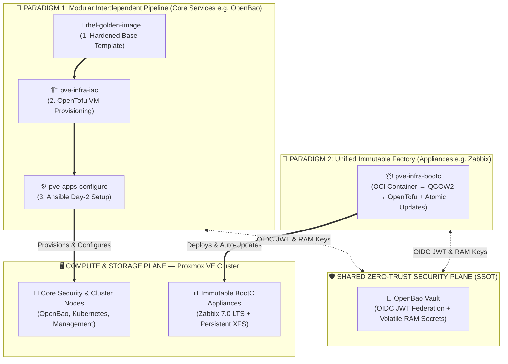

# 👋 Hi, I'm RAK. Herizo - DevSecOps & Infrastructure Engineer

I design and automate **sovereign, self-hosted cloud infrastructures** on **Proxmox VE**. My work focuses on **Infrastructure-as-Code**, **immutable RHEL 9 Linux systems (`bootc`)**, and **Zero-Trust DevSecOps pipelines** where secrets never touch disk and every server lifecycle is reproducible from code.

---

## 🏗️ Featured Architecture: Sovereign Proxmox VE Cloud Platform

My infrastructure portfolio demonstrates **two complementary enterprise deployment paradigms**—a **modular 3-repository pipeline** (used to bootstrap core security infrastructure like **OpenBao**) and a **unified immutable Image Mode factory** (used to deploy self-contained appliances like **Zabbix 7.0 LTS**)—unified by a **secretless OIDC security plane**.

---

## 🧩 Ecosystem Repositories

### 1. Interdependent 3-Repository Pipeline *(Modular Infrastructure Lifecycle)*
Built for foundational infrastructure and multi-node clusters where image hardening, compute provisioning, and configuration management are cleanly decoupled—**proven in production to bootstrap my central OpenBao secrets cluster**:

| Stage | Repository | Role & Architecture | Core Stack |
| :--- | :--- | :--- | :--- |
| **01** | **[`rhel-golden-image`](https://github.com/herizomarc/rhel-golden-image)** | **Hardened Base Image Factory** | RHEL 9, Packer / Cloud-Image, CIS Hardening, `cloud-init`, `qemu-guest-agent` |
| **02** | **[`pve-infra-iac`](https://github.com/herizomarc/pve-infra-iac)** | **Multi-VM Compute & Network** | OpenTofu, Proxmox VE, GitLab HTTP Remote State, Static IPv4 Allocation |
| **03** | **[`pve-apps-configure`](https://github.com/herizomarc/pve-apps-configure)** | **Idempotent Day-2 Automation** | Ansible, Rootless Podman, In-Memory `ssh-agent`, Service Orchestration |

### 2. Unified Immutable Factory *(RHEL 9 Image Mode / BootC)*
Built for self-contained sovereign appliances where OS packages, custom SELinux policies, and infrastructure definitions live in a **single GitOps repository**—**proven in production to compile and deploy Zabbix 7.0 LTS with atomic pull upgrades**:

| Repository | Role & Architecture | Core Stack |
| :--- | :--- | :--- |
| **[`pve-infra-bootc`](https://github.com/herizomarc/pve-infra-bootc)** | **Unified Immutable OS & IaC Factory** | RHEL 9 `bootc`, Podman, `bootc-image-builder`, OpenTofu, Cloud-Init `scsi2` |

---

## 🏆 Key Production Achievements

* **100% Secretless CI/CD Execution:** Eliminated all static credentials, `.tfvars` secrets, and on-disk SSH keys across 4 repositories by engineering dynamic **GitLab OIDC JWT** federation with **OpenBao** and volatile RAM injection (`/dev/shm` & `ssh-agent`).
* **Zero-Touch Immutable Appliance Delivery:** Engineered an end-to-end **RHEL 9 Image Mode (`bootc`)** factory capable of compiling custom SELinux policies (`krb5_keytab_t`), translating OCI images into UEFI QCOW2 disks, and provisioning self-configuring **Zabbix 7.0 LTS** servers with isolated XFS data volumes (`scsi1`).
* **Atomic OS Lifecycle Management:** Implemented non-destructive, pull-based operating system upgrades (`bootc upgrade --apply`) with instant rollback guarantees while preserving persistent PostgreSQL databases across reboots.
* **Sovereign Enterprise Security & Networking:** Applied **RHCSA** and **CCNA** standards to enforce strict SELinux confinement, VLAN network segmentation, and automated `firewalld` baselines across all virtualized workloads.

---

## 🔭 Engineering Roadmap & Next Projects

Upcoming initiatives currently in design and prototyping to expand the sovereign cloud platform:

| Status | Initiative | Architectural Scope & Target Stack |
| :--- | :--- | :--- |
| 🚧 **In Progress** | **Sovereign Kubernetes Cluster (`k8s-pve-gitops`)** | Multi-node High-Availability Kubernetes deployment provisioned via `pve-infra-iac` with Cilium CNI, MetalLB, and FluxCD / ArgoCD GitOps delivery. |
| 📅 **Planned** | **Full-Stack Observability & Alerting Mesh** | Expanding **Zabbix 7.0 LTS** (`pve-infra-bootc`) with automated host discovery, Prometheus exporters, and Grafana dashboards across all Proxmox nodes. |
| 📅 **Planned** | **Automated PKI & Short-Lived SSH Certificates** | Leveraging **OpenBao PKI & SSH Secrets Engines** to replace static Ed25519 keys with dynamic, 1-hour signed SSH certificates and internal TLS automation. |

---

## 🎓 Certifications & Core Domains

* **Red Hat Certified System Administrator (RHCSA)** — Enterprise Linux administration, SELinux enforcement, storage management (LVM/XFS), systemd, and container operations.
* **Cisco Certified Network Associate (CCNA v7 — ITN, SRWE, ENSA)** — Enterprise routing & switching, VLAN segmentation, OSPF, ACLs, NAT, and network security fundamentals.
